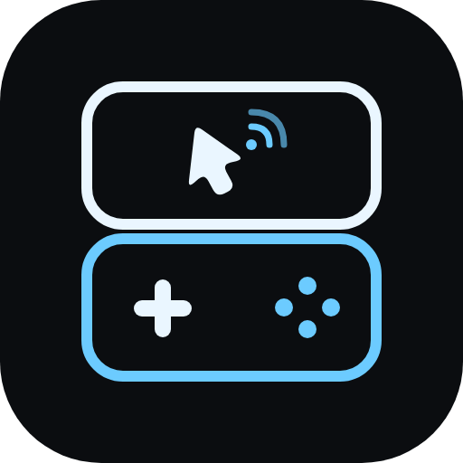
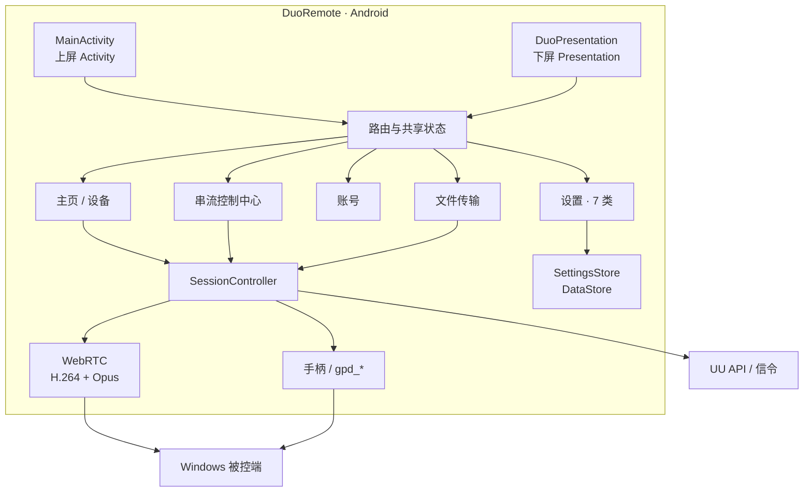
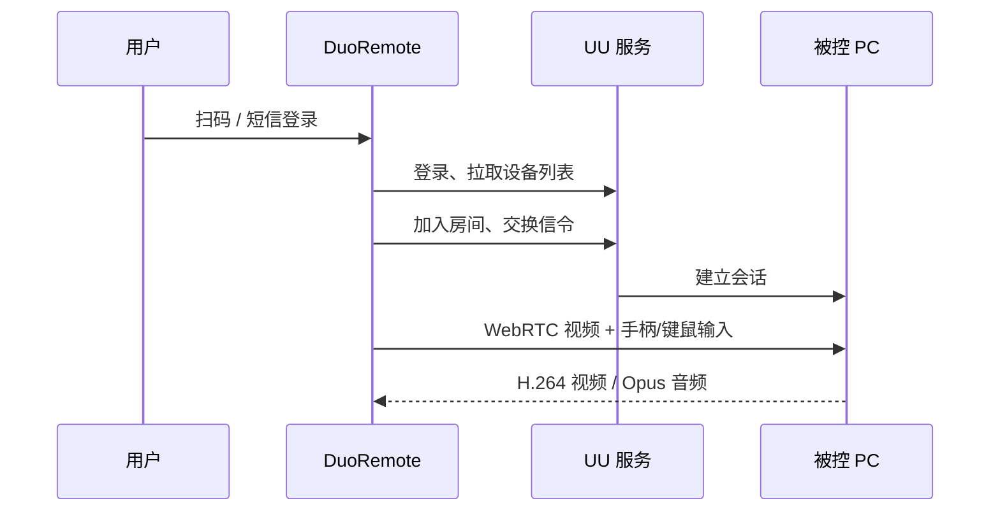

<p align="center">
  
</p>

<h1 align="center">DuoRemote</h1>

<p align="center">
  面向双屏 Android 掌机的非官方 UU 远程客户端<br />
  <sub>Unofficial UU Remote client for dual-screen Android handhelds</sub>
</p>

<p align="center">
  <b>Status: development</b> · v0.3.0-dev · Android 8.0+ · GPL-3.0
</p>

> **开发中，暂不发布 Release，也不在仓库提供 APK。** 当前版本已在 Retroid Pocket Duo 上完成串流、控制中心、单屏模式和手柄焦点验收，但仍有部分边界功能未实现或未做故障注入测试。
>
> 本项目是非官方第三方客户端，与网易 / UU 远程无隶属关系。请自行确认账号与目标电脑的使用授权。

---

## 目录

- [这是什么](#这是什么)
- [当前状态](#当前状态)
- [功能与边界](#功能与边界)
- [技术栈](#技术栈)
- [架构](#架构)
- [连接流程](#连接流程)
- [项目结构](#项目结构)
- [构建与运行](#构建与运行)
- [签名、隐私与安全](#签名隐私与安全)
- [设计资料](#设计资料)
- [路线图](#路线图)
- [许可证与免责声明](#许可证与免责声明)

## 这是什么

DuoRemote 是一个 Kotlin / Jetpack Compose 写的 Android 远程桌面客户端，目标设备是 **Retroid Pocket Duo、AYN Thor** 这类上下双屏、带实体手柄的 Android 掌机。

它直接实现 UU 远程的主控协议与标准 Android WebRTC，不依赖官方 Android 客户端，也不使用官方 `libstreamer.so`：

- **双屏**：上屏只读视频/详情，下屏是唯一操作面；单屏时整个屏幕是唯一操作面。
- **手柄优先**：焦点环常驻，方向键/左摇杆移动焦点，B 确认、A 返回，L1/R1 切分类，L2/R2 切控制中心子页。
- **串流**：UU 信令 + WebRTC H.264/Opus；支持分辨率、帧率、画质、码率、画面缩放。
- **本地优先**：控制中心、设置、帮助、本地菜单都能在不退出串流的情况下操作。

## 当前状态

| 项目 | 状态 |
| --- | --- |
| 版本 | `0.3.0`（development，versionCode 3） |
| 主要验证设备 | Retroid Pocket Duo（双屏 1920×1080 + 1280×960，Android 掌机） |
| 单屏模式 | 上屏 Activity / 下屏 Presentation 均可作为唯一屏 |
| 自动测试 | 99 个 JVM 单测通过 |
| 构建 | debug / R8 release（默认未签名）通过；lint 通过 |
| 发布 | **没有 GitHub Release，没有随仓库分发的 APK** |
| 网络验收 | 1080p60 / 720p30、控制中心重连、仅观看、fit/fill 缩放、文件传输与文件夹上下传已真机验证 |
| 尚未复测 | 断网自动重连、剪贴板双向、手柄震动、双屏热插拔、码率逐档 |

## 功能与边界

### 已可用

| 模块 | 内容 |
| --- | --- |
| 登录 | 扫码登录、短信登录、token 持久化；登录页支持单屏二维码 |
| 设备 | 设备列表、在线状态、手动刷新、连接偏好摘要 |
| 串流 | 加入房间、信令、control、WebRTC H.264/Opus；1080p60 / 720p30 |
| 双屏 | 上屏 Activity 只读视频/摘要；下屏 Presentation 承载完整 UI |
| 单屏 | 上屏或下屏作为唯一宿主；设置、账号、控制中心、本地菜单均有单屏布局 |
| 手柄 | XInput 位掩码直通、16ms `gpd_update`、零值释放、`gpd_disconnect`、震动消息 |
| 手柄映射 | 桌面 / FPS / 模拟器三套模板，实体手柄转键鼠；关闭时仍直通电脑；设置与控制中心均可切换 |
| 焦点 | 方向键/左摇杆移动、B 确认、A 返回、L1/R1 分类、L2/R2 子页、START 帮助 |
| 控制中心 | 画面/显示、外设、安全、更多；画面改动待应用，X 应用并重连 / Y 取消 |
| 设置 | 画面、屏幕、外设、安全、网络、外观、关于 7 类；DataStore 持久化 |
| 观看模式 | 仅观看：客户端侧释放并拦截手柄/键鼠/触摸/文字，暂停剪贴板；非被控端强制 |
| 画面缩放 | `fit` / `fill` / `original`；触屏坐标映射同步；本地即时生效，不重连 |
| 输入 | 触摸板、直接触摸视频、内置拼音、系统 IME、快捷键、文字剪贴板（默认关） |
| 文件传输 | 控制中心「更多」；远端目录浏览、单文件/多文件上传下载、文件夹（含子目录）上传与下载；本机文件用 app 内自建浏览页，应用目录免授权，另可一次性授权一个本机文件夹；重名自动改名 |
| 诊断 | 可选 FPS / 码率 / RTT / 丢包统计；默认关闭 |
| 品牌 | A1 双屏手柄 adaptive icon；登录、上屏摘要、账号、关于使用同一双色短标 |

### 部分可用 / 未完整验收

| 模块 | 说明 |
| --- | --- |
| 断网自动重连 | 2/4/8 秒退避 + 5 秒看门狗已实现，未做真实断网故障注入 |
| 剪贴板双向 | 文字 TEXT 通道与回声抑制已实现，单测覆盖，未做完整真机往返 |
| 手柄震动 | `gpd_vibration` 协议已接，未逐游戏/逐强度验证 |
| SendToRom 兜底 | `text_input` 失败回退 TEXT 通道，未做真机故障注入 |
| 双屏热插拔 | Presentation 随 display 增减重建，未做完整拔插压力测试 |
| 码率逐档 | 自动 / 20 / 50 / 100 Mbps 选项存在，未逐档长期观察 |

### 明确不做（v1 边界）

| 功能 | 原因 / 计划 |
| --- | --- |
| 拖放、剪贴板文件 | 文件夹（含子目录）与多文件顺序传输已落地；拖放与剪贴板文件后续 |
| 多显示器 / 超级屏 / 虚拟屏 | 需要 STREAMER 多流与电脑端能力，后续 |
| HDR / 4K / 144Hz / H.265 / AV1 | 需要协议档位、编码器与硬解能力，后续 |
| 远程开机（WOL） | **暂不做**：没有可唤醒的测试硬件/被控端条件，无法验收 |
| 重启 / 关机 / 定时关机 | 需要电脑端 RPC，后续 |
| 终端 / 端口映射 | 需要电脑端 RPC 与端口映射，后续 |
| 按键映射 / 虚拟按键 / 宏 / 轮盘 | 不做触屏虚拟按键；实体手柄→键鼠模拟列为 P2 |
| 麦克风 / 语音 | v1 不采集 |
| 后台小窗（PiP） | 单屏串流按 Home 进入画中画，已在 Duo 验证 |
| 多语言 / 更新检查 | 后续 |
| 被控端强制的观看模式 | 当前“仅观看”是本机客户端门控，不是安全隔离 |

## 技术栈

| 层 | 选型 |
| --- | --- |
| 语言 | Kotlin `1.9.23`，JDK 17 |
| UI | Jetpack Compose BOM `2024.04.01`，Material 3，自定义双屏主题/焦点环 |
| 宿主 | 单 Activity + `Presentation` 副屏；Activity 作用域共享状态，不用导航图 |
| 构建 | AGP `8.4.0`，Gradle `8.7`，compileSdk/targetSdk 34，minSdk 26 |
| 网络 | OkHttp `4.12.0`，Gson `2.10.1`，Kotlin Coroutines `1.8.0` |
| 实时 | `io.github.webrtc-sdk:android:125.6422.07`（H.264 / Opus） |
| 存储 | DataStore Preferences；EncryptedSharedPreferences / Android Keystore 保存敏感材料 |
| 二维码 | ZXing core `3.5.3` |
| 测试 | JUnit 4，MockWebServer；99 个 JVM 单测 |
| CI | GitHub Actions：单测 + debug APK artifact；**不创建 Release** |

## 架构



关键设计：

- **上屏只读**：上屏不放可聚焦控件；下屏/单屏是唯一焦点树，因此不需要“上下屏切焦点”键。
- **路由在 Activity 作用域**：`Home / Settings / Account / ControlCenter` 由 Activity 持有，Presentation 重建不会丢状态。
- **控制中心草稿**：画面类改动先写入 draft，应用时才落盘并重连；外设/安全即时生效。
- **输入抑制**：本地菜单、IME、设置、帮助打开时暂停直通并释放按键，关闭后恢复。

## 连接流程



## 项目结构

```text
uuremote-duo/
├── app/
│   └── src/main/
│       ├── java/com/sour/duoremote/
│       │   ├── MainActivity.kt        # 路由、双屏宿主、集中按键分发
│       │   ├── data/                 # SettingsStore 等本地状态
│       │   ├── protocol/             # UU API / 信令 / WebRTC / QR
│       │   ├── session/              # SessionController、手柄、剪贴板
│       │   └── ui/                   # 主页 / 设置 / 控制中心 / 串流 / 组件
│       └── res/                      # adaptive icon、主题、字符串
├── docs/
│   ├── BUILDING.md                   # 构建与真机调试
│   ├── feature-matrix.md             # 功能矩阵与边界
│   ├── feature-parity.md             # 官方/第三方对照
│   ├── file-transfer.md              # 文件传输协议与限制
│   ├── gamepad-emulation.md          # 桌面/FPS/模拟器手柄映射
│   ├── v1-checklist.md               # 验收清单
│   └── ui/                           # HTML 设计稿、图标、规范
├── .github/workflows/android.yml     # 单测 + debug 构建
├── LICENSE                           # GPL-3.0
└── README.md
```

## 构建与运行

### 环境

- JDK 17
- Android SDK 34（compileSdk/targetSdk）
- Gradle Wrapper 8.7（仓库自带）
- Android 设备/模拟器：API 26+

```bash
# Linux / macOS / Git Bash
export JAVA_HOME=/path/to/jdk-17
./gradlew :app:testDebugUnitTest :app:lintDebug :app:assembleDebug
```

```bat
:: Windows
gradlew.bat :app:testDebugUnitTest :app:lintDebug :app:assembleDebug
```

APK 输出：

```text
app/build/outputs/apk/debug/app-debug.apk
```

更细的环境、代理绕过、双屏 display id 和 adb 命令见 [docs/BUILDING.md](docs/BUILDING.md)。

### CI

GitHub Actions 在 `push` / `pull_request` 时运行 `:app:testDebugUnitTest` 与 `:app:assembleDebug`，
并上传 debug APK artifact；**不创建 Release**。

### 签名材料

- 仓库**不包含**官方签名 key、keystore、token 或官方 APK。
- 首次运行时从用户本地提供的官方 UU TV APK 导入 24 字节签名材料，校验指纹后加密保存；不会写入日志。
- Release 构建默认不签名；需要时通过本地 `keystore.properties` 或环境变量提供，相关文件已被 `.gitignore` 排除。

## 签名、隐私与安全

这个仓库刻意不包含：

- 官方 APK、提取出的签名 key、keystore、token、二维码内容
- 账号昵称、手机号、设备主机名、SDP、IP、连接日志
- 真机测试截图、设计稿渲染截图（`docs/ui/shots/` 已忽略）
- 构建产物、`local.properties`、`.tmp/`、`research/`

提交 issue / PR 时请不要粘贴 token、二维码、SDP、IP、账号或完整日志。日志中的敏感字段应在应用侧脱敏。

## 设计资料

- 设计规范：[docs/ui/spec.md](docs/ui/spec.md)、[docs/ui/tokens.md](docs/ui/tokens.md)、[docs/ui/focus.md](docs/ui/focus.md)
- 图标定稿：[docs/ui/icon.md](docs/ui/icon.md)
- 图标方向与位置对比：[docs/ui/icon-concepts.html](docs/ui/icon-concepts.html)、[docs/ui/icon-a-positions.html](docs/ui/icon-a-positions.html)
- 页面设计稿：[docs/ui/](docs/ui/)
- 最终图标：A1「双屏手柄」，与 Bili-Duo 同一套扁平双屏语言；黑底、白描上屏、青描下屏。
- **不采用单色/主题图标**：单色会让上下屏与手柄细节糊在一起；adaptive icon 只有 background + foreground。

## 路线图

| 阶段 | 内容 |
| --- | --- |
| 当前 | 文件传输：远端目录浏览、单文件/多文件上传下载、文件夹（含子目录）上传与下载；应用内本机浏览 + 一次性文件夹授权已真机验收 |
| 下一步 | 拖放、剪贴板文件；多显示器/超级屏（依赖电脑端能力） |
| 后续 | HDR/4K/H.265、远开/关机、终端/端口映射 |
| P2 | 自定义手柄映射模板（不做虚拟按键/宏/轮盘） |

## 许可证与免责声明

- 代码以 **GNU General Public License v3.0** 发布，见 [LICENSE](LICENSE)。
- 本项目为**非官方**第三方客户端，与网易、UU 远程及其关联公司无隶属或背书关系。
- “UU 远程”、“网易”等名称/商标归其各自权利人所有。
- 本项目按“现状”提供，不附带任何明示或暗示担保；使用前请确认账号、设备和远程控制授权，风险自负。
