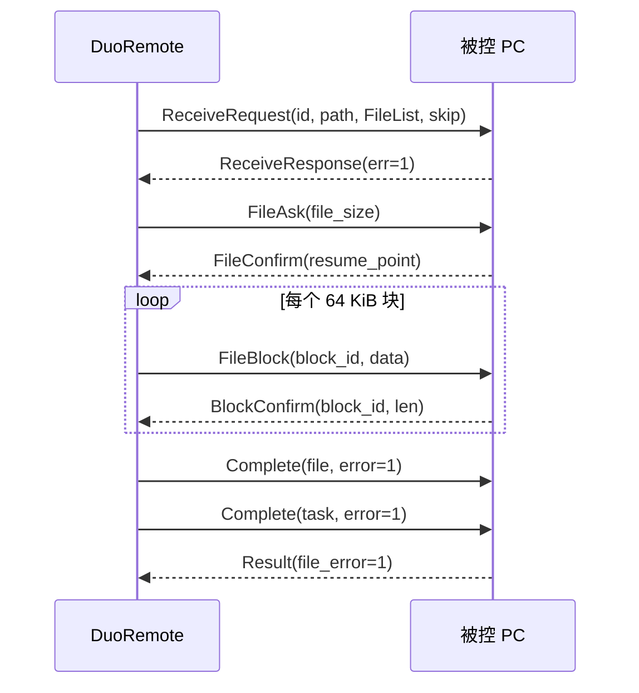
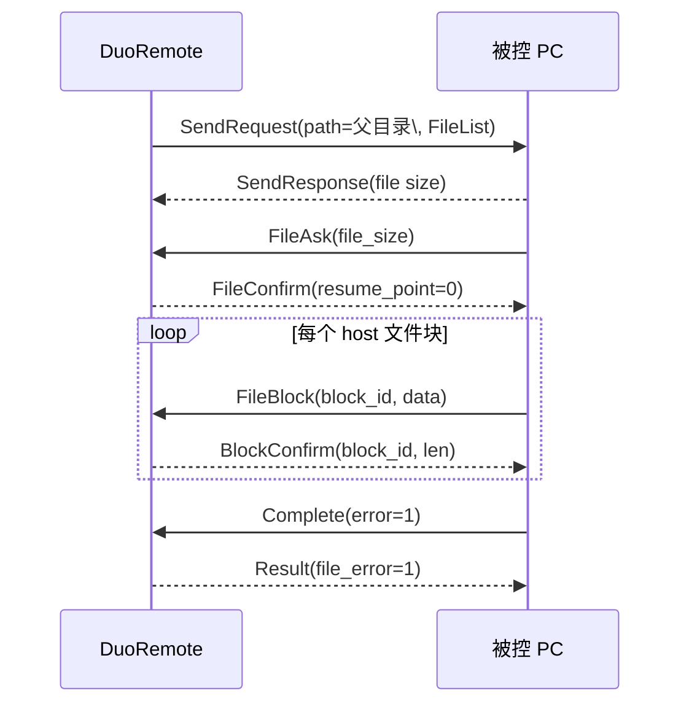

# 文件传输（MVP）

> 状态：协议、状态机、单测与 RP Duo + Windows 电脑端的目录浏览/单文件上下传已验收。
> 范围：远端目录浏览、单文件上传、单文件下载。文件夹批量、拖放、剪贴板文件、下载断点续传不在本版。
>
> 本机文件选择已改为 **app 内自建浏览页**：应用专属传输目录无需权限，另可选一次授权一个
> 本机文件夹；之后每次上传/下载都不再启动系统文件管理器。

## 入口与布局

- 串流内控制中心 → **更多 → 文件传输**。
- 双屏：上屏显示只读的目录/进度概览，下屏负责浏览、上传、下载与队列。
- 单屏：整个屏幕是文件页；手柄焦点在文件行。
- 「仅观看」开启时入口禁用；若在文件页开启，会取消当前任务并退回。

## 协议路径

五条 SCTP 通道在会话建立时已经创建。本功能使用：

| 用途 | 通道 | 帧类型 |
| --- | --- | --- |
| SimpleAction 握手 | `CONTROL_DATA_CHANNEL` | binary |
| 文件 FTP RPC | `TEXT_DATA_CHANNEL` | 官方 PPID 51（非 binary 帧，payload 仍是原始 protobuf） |
| 现有文字/剪贴板 | `TEXT_DATA_CHANNEL` | binary |

`ConnectOptions` 的 field 11 声明 `FeatureFlag`：

```text
1 ff_capture_setting = 4
2 ff_simple_action  = 3
3 ff_system_metrics = 3
6 ff_file_transfer_ftp  = 2   # 文件列表压缩
7 ff_file_transfer_ftp2 = 2   # resumable / speedy
8 ff_clipboard = 3
9 ff_qos_stat  = 1
```

握手使用 `Main.Message.simple_action` (field 3)：客户端发 action 0，收到 echo 后回 action 1 +
`FeatureFlag`。文件 RPC 使用 `Main.Message` 的 field 21/22：

```text
Main.Message
  1 seq
  2 timestamp
  21 RpcRequest
      1 RequestHeader { 1 request_id }
      8 FileTransferFtpRequest
  22 RpcResponse
      1 ResponseHeader { 1 request_id }
      4 FileTransferFtpResponse
```

`request_id` 对客户端发出的文件 RPC 取 `TaskId.task_id`；对 host 发来的请求，响应原样回传
host 的 `request_id`。

### FileTransferFtpRequest oneof

| field | 消息 | 用途 |
| --- | --- | --- |
| 1 | `FileTransferReceiveRequest` | 上传：声明目标目录与文件列表 |
| 2 | `FileTransferSendRequest` | 下载：请求远端发送文件 |
| 3 | `FileTransferAsk` | 上传：询问文件大小/续传点 |
| 4 | `FileTransferBlock` | 文件块 |
| 9 | `FileTransferComplete` | 结束/取消 |
| 10 | `ReadDir` | 列目录 |

### FileTransferFtpResponse oneof

| field | 消息 | 用途 |
| --- | --- | --- |
| 1 | `FileTransferReceiveResponse` | 上传请求确认 |
| 2 | `FileTransferSendResponse` | 下载文件元数据 |
| 3 | `FileTransferConfirm` | 上传确认/续传点 |
| 4 | `FileTransferBlockConfirm` | 文件块确认 |
| 6 | `FileTransferResult` | 任务结果 |
| 7 | `FileDirectory` | 目录列表（`dir_data` 为 zlib 压缩的 `DirectoryData`） |

文件列表 `list_data` 是 zlib 压缩的 `FileList`；单文件上传时同时带 `files` 和 `list_data`。
块大小 64 KiB，上传逐块等待确认；下载按 host 的块序号确认。

## 上传



- 同名文件策略为 `FOS_SKIP`；host 返回 `skip=true` 时页面显示“已跳过同名文件”。
- `resume_point > 0` 时跳过已上传字节后继续；没有实现暂停/续传 UI。

## 下载



- 下载块序号从 **1** 开始；上传块序号从 **0** 开始。
- 写入目标由 app 内本机文件页选择；失败/取消时尽量删除未完成的空文件，已写入的部分文件可能保留。
- 下载续传、暂停、文件夹递归未实现。

## 多文件批量

- 本机页上传模式每个文件行有复选框；可以跨目录选中多个文件，按钮显示「上传已选 N 个」，
  也支持手柄 `Y` 对当前行多选。
- 远端页文件行同样有复选框；`L2` 对当前行多选，`Y`/「下载已选 N 个」把选中的文件加入下载队列。
- 批量不是并发传输：仍由同一个 `FileTransferEngine` 顺序执行，一个文件收到 `Result` 后再开始
  下一个；队列显示「第 x/y 个」，最终提示“批量上传/下载完成（N 个文件）”。
- 上传文件在轮到它时才打开流；下载目标在轮到它时才创建，避免一次占用大量文件描述符。
- 任一文件失败会停止整个队列并保留错误；已完成的文件不会回滚。下载重名按
  `name (1).ext` 生成新文件。

## 本机文件（app 内浏览）

文件页的「上传」「下载」不再调用系统文件选择器，而是打开 app 自建的本机文件页：

- **应用目录**：`Android/data/com.sour.duoremote/files/DuoRemote`。应用自身可读写，
  不需要运行时权限，也不申请 `MANAGE_EXTERNAL_STORAGE`。
- **授权文件夹**：首次点「授权文件夹」时打开一次系统的
  `ACTION_OPEN_DOCUMENT_TREE`，用 `takePersistableUriPermission` 保存读/写权限。
  之后通过 `DocumentsContract` 直接列目录、读文件和创建文件；每次传输都不会再弹系统页面。
- 上传：在本机页选中文件 → `openInputStream`/`FileInputStream` → 现有上传状态机。
- 下载：在本机页进入目标文件夹 → 按远端文件名创建文件（重名自动改为 `name (1).ext`）
  → `openOutputStream`/`FileOutputStream` → 现有下载状态机。
- 应用目录和授权文件夹都支持进入子目录、上一级、刷新；手柄 B 打开/确认、A 返回、
  X 刷新、L1/R1 在两种根之间切换。
- 授权文件夹只接受读+写权限；系统只给只读时会提示重新授权。授权被系统收回后，
  本机页会显示授权提示，不会回退到系统文件管理器。授权页顶部提供「撤销授权」，
  会释放持久化 URI 权限并切回应用目录。
- 第一次授权仍会短暂打开系统页面。串流期间授权时，`SessionKeepAliveService`
  （短时前台服务、`dataSync`）会尽量保持会话；真机已验证授权完成后串流仍在。

## 目录浏览

- 默认从 `C:\` 开始；进入文件夹、上一级。
- `ReadDir` → `FileDirectory`；`FileEntry.entry_type` 0/2/3 视为目录，4/5 视为文件。
- 目录列表 15 秒无响应会提示超时；传输 30 秒无进展会失败并发送取消。

## 隐私与安全

- 不访问任意本机路径：只列应用专属目录或用户一次性授权的单个文件夹；不申请全盘文件权限。
- 授权 URI 持久化在 DataStore；不记录文件内容、token、签名 key 或远端路径日志。
- 「仅观看」下入口禁用，避免在只读会话中修改远端文件。
- 远端文件仍由被控端权限约束；本功能不是提权工具。

## 验证

```bash
./gradlew :app:testDebugUnitTest
```

覆盖：

- `FileTransferCodecTest`：Main/RPC 包络、目录/文件列表、zlib、块确认、feature flags。
- `FileTransferEngineTest`：目录排序、上传逐块确认与双 Complete、下载块/回执 request_id、超时、路径边界。
- `LocalFilesUiStateTest`：本机页打开/根切换、进入/上一级、选择、过期目录结果丢弃、授权提示。

2026-11-19 RP Duo + Windows 电脑端实测：`C:\` 与 `C:\Users\Public` 目录浏览；应用目录
上传/下载 27 B 文件；一次授权 `Documents/DuoRemoteTest` 后，从授权文件夹上传及下载到该文件夹
均为 27 B；重名自动改为 `grant-test (1).txt`；授权页关闭后串流保持连接。尚未实测 >100 MB
文件、取消/失败清理和 15/30 秒超时。真机验收项见 [v1-checklist.md](v1-checklist.md) 第 9 节。
