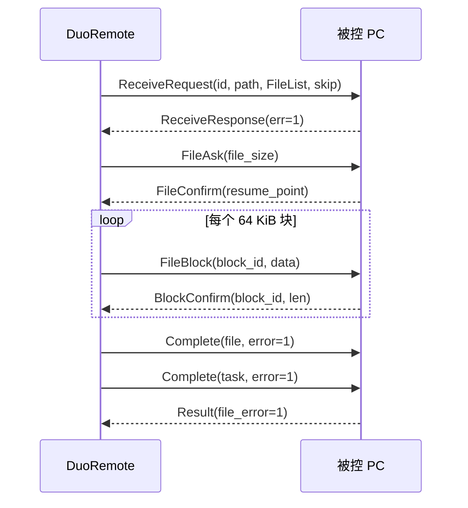
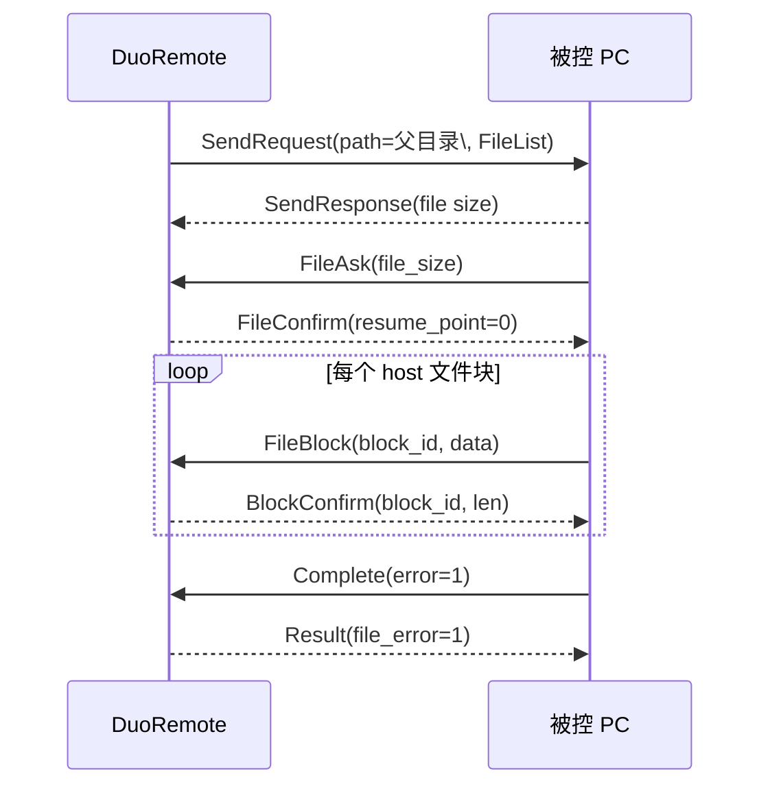

# 文件传输（MVP）

> 状态：代码、协议编解码与状态机单测完成；**尚未在 RP Duo + Windows 电脑端做真机验收**。
> 范围：远端目录浏览、单文件上传、单文件下载。文件夹批量、拖放、剪贴板文件、下载断点续传不在本版。

## 入口与布局

- 串流内控制中心 → **更多 → 文件传输**。
- 双屏：上屏显示只读的目录/进度概览，下屏负责浏览、上传、下载与队列。
- 单屏：整个屏幕是文件页；手柄焦点在文件行。
- 「仅观看」开启时入口禁用；若在文件页开启，会取消当前任务并退回。

## 协议路径

五条 SCTP 通道在会话建立时已经创建。本功能使用：

| 用途 | 通道 | 帧类型 |
| --- | --- | --- |
| SimpleAction 握手 | `CONTROL_DATA_CHANNEL` | binary |
| 文件 FTP RPC | `TEXT_DATA_CHANNEL` | 官方 PPID 51（非 binary 帧，payload 仍是原始 protobuf） |
| 现有文字/剪贴板 | `TEXT_DATA_CHANNEL` | binary |

`ConnectOptions` 的 field 11 声明 `FeatureFlag`：

```text
1 ff_capture_setting = 4
2 ff_simple_action  = 3
3 ff_system_metrics = 3
6 ff_file_transfer_ftp  = 2   # 文件列表压缩
7 ff_file_transfer_ftp2 = 2   # resumable / speedy
8 ff_clipboard = 3
9 ff_qos_stat  = 1
```

握手使用 `Main.Message.simple_action` (field 3)：客户端发 action 0，收到 echo 后回 action 1 +
`FeatureFlag`。文件 RPC 使用 `Main.Message` 的 field 21/22：

```text
Main.Message
  1 seq
  2 timestamp
  21 RpcRequest
      1 RequestHeader { 1 request_id }
      8 FileTransferFtpRequest
  22 RpcResponse
      1 ResponseHeader { 1 request_id }
      4 FileTransferFtpResponse
```

`request_id` 对客户端发出的文件 RPC 取 `TaskId.task_id`；对 host 发来的请求，响应原样回传
host 的 `request_id`。

### FileTransferFtpRequest oneof

| field | 消息 | 用途 |
| --- | --- | --- |
| 1 | `FileTransferReceiveRequest` | 上传：声明目标目录与文件列表 |
| 2 | `FileTransferSendRequest` | 下载：请求远端发送文件 |
| 3 | `FileTransferAsk` | 上传：询问文件大小/续传点 |
| 4 | `FileTransferBlock` | 文件块 |
| 9 | `FileTransferComplete` | 结束/取消 |
| 10 | `ReadDir` | 列目录 |

### FileTransferFtpResponse oneof

| field | 消息 | 用途 |
| --- | --- | --- |
| 1 | `FileTransferReceiveResponse` | 上传请求确认 |
| 2 | `FileTransferSendResponse` | 下载文件元数据 |
| 3 | `FileTransferConfirm` | 上传确认/续传点 |
| 4 | `FileTransferBlockConfirm` | 文件块确认 |
| 6 | `FileTransferResult` | 任务结果 |
| 7 | `FileDirectory` | 目录列表（`dir_data` 为 zlib 压缩的 `DirectoryData`） |

文件列表 `list_data` 是 zlib 压缩的 `FileList`；单文件上传时同时带 `files` 和 `list_data`。
块大小 64 KiB，上传逐块等待确认；下载按 host 的块序号确认。

## 上传



- 同名文件策略为 `FOS_SKIP`；host 返回 `skip=true` 时页面显示“已跳过同名文件”。
- `resume_point > 0` 时跳过已上传字节后继续；没有实现暂停/续传 UI。

## 下载



- 下载块序号从 **1** 开始；上传块序号从 **0** 开始。
- 写入目标由 Android SAF `CreateDocument` 选择；失败/取消可能留下部分文件。
- 下载续传、暂停、文件夹递归未实现。

## 目录浏览

- 默认从 `C:\` 开始；进入文件夹、上一级。
- `ReadDir` → `FileDirectory`；`FileEntry.entry_type` 0/2/3 视为目录，4/5 视为文件。
- 目录列表 15 秒无响应会提示超时；传输 30 秒无进展会失败并发送取消。

## 隐私与安全

- 不访问任意本机路径：上传文件由 SAF 选择，下载目标由 SAF 创建。
- 不记录文件内容、token、签名 key 或远端路径日志。
- 「仅观看」下入口禁用，避免在只读会话中修改远端文件。
- 远端文件仍由被控端权限约束；本功能不是提权工具。

## 验证

```bash
./gradlew :app:testDebugUnitTest
```

覆盖：

- `FileTransferCodecTest`：Main/RPC 包络、目录/文件列表、zlib、块确认、feature flags。
- `FileTransferEngineTest`：目录排序、上传逐块确认与双 Complete、下载块/回执 request_id、超时、路径边界。

真机验收项见 [v1-checklist.md](v1-checklist.md) 第 9 节。
